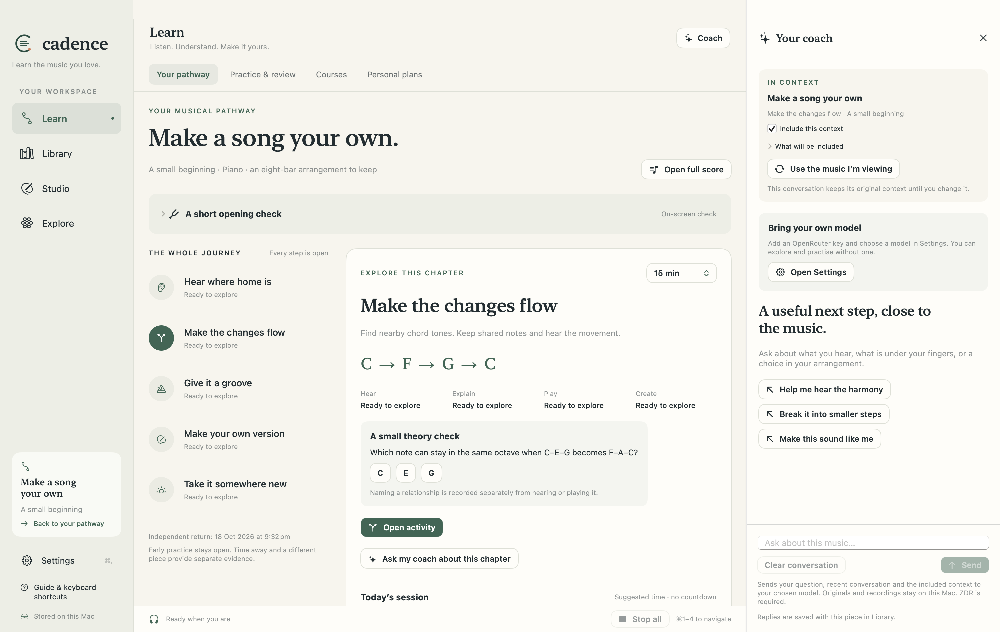

<p align="center"></p>

# Cadence

**Learn the music you love. Make it your own.**

A free, open-source music learning studio for Mac, connecting **piano, guitar, music theory, composition and arrangement** through guided musical pathways.

Start with a piece, a book or an idea. Hear it, understand it, find it under your fingers, then make something of your own. Cadence connects the full score to focused practice, independent returns and your creative work. Optional AI coaching helps you understand the music and find a useful next step; it uses your own OpenRouter account and credits.

The first complete pathway, **Make a song your own**, connects an opening check, ear training, chord changes, accompaniment and an eight-bar arrangement. Its course map and transparent session suggestions are available in current source builds; the downloadable 0.36.1 preview predates this pathway. Hearing, explaining, playing and creating retain separate evidence. Current source builds organise the workspace into **Learn, Library, Studio and Explore**, with coaching beside the current music. No paid lessons, advertising, streak penalties or account required.

[Download the public preview](https://github.com/cigrainger/cadence/releases/tag/v0.36.1) · [User guide](https://cigrainger.github.io/cadence/docs/) · [Project website](https://cigrainger.github.io/cadence/) · [Contribute](CONTRIBUTING.md)



## One musical journey, connected tools

- **Follow a pathway:** start with original music or four reviewed bars from your library. See the whole journey, revisit a difficulty and keep a linked arrangement.
- **Explore:** keys, scales, modes, chord tones, guitar shapes and piano visualisations. Guitar voicings are calculated from tuning and chord intervals; they are not a scraped chord database.
- **Compose:** linked notation and guitar tab, piano staves, chord symbols, MIDI step entry, playback and editable MusicXML import/export.
- **Bring your music:** a library separating imported scores and your compositions. Optional PDF transcription produces an editable draft beside its source. EPUB/PDF chapters can support reviewed, source-linked courses.
- **Practise:** functional ear training and solfège, MIDI play-along, rhythms, hands separately/together, phrase takes, guitar triads, guide tones and reharmonisation. Focus on a difficulty, return to the phrase, then try independently later.
- **Create:** write an answer or alternative ending, save a reharmonisation, and record MIDI improvisations linked to the original piece.
- **Keep the basics nearby:** metronome, tuner, pitch matching and optional AI explanations.

This is an early public release. AI transcription is fallible and needs review. Cadence is not a lossless general-purpose engraving tool. Guitar microphone work is monophonic pitch matching, not reliable polyphonic chord recognition. See the [guide](https://cigrainger.github.io/cadence/docs/) for each activity's boundaries.

## Install

The published binary is for **Apple silicon, macOS 14 or later**. Download the app ZIP and verify its SHA-256 against the release's `SHA256SUMS.txt`, then extract and move Cadence to Applications. Releases include matching source, dependency records and notes.

The **0.36.1 app ZIP is Developer ID signed and Apple notarised**, with a stapled ticket. macOS still shows its normal first-open confirmation for a downloaded app. Earlier 0.36.0 downloads were ad hoc signed. Intel builds are not yet release-tested; local builds remain available.

## Build from source

Requires macOS 14+, Xcode with Swift 6.2 or later, Python 3.11+ for verification/site tooling, and Node.js 24+ for website interaction checks. Every first-party app, core and test target uses Swift 6 language mode. No Xcode project or npm install is needed for the app. SwiftPM fetches the exact ZIPFoundation version in `Package.resolved`.

```sh
git clone https://github.com/cigrainger/cadence.git
cd cadence
./build.sh
open dist/Cadence.app
```

`CADENCE_BUILD_DIR` and `CADENCE_APP_PATH` optionally select the build cache and output bundle. Local builds default to ad-hoc signing; maintainers use the [signing and notarisation guide](Docs/RELEASING.md) for public downloads. The build stages a fresh bundle; it only replaces an output recognised as Cadence.

```sh
python3 Scripts/check_repository.py
./verify.sh --tests-only                 # core + native state tests, unit coverage
./verify.sh                              # production + instrumented native journeys, combined coverage
python3 Scripts/build_site.py            # site/dist, including internal-link checks
```

Full verification requires an unlocked Mac desktop and Accessibility access for the invoking terminal. CI explicitly skips accessibility actions and live audio-output checks while retaining offline audio, virtual MIDI, native previews and coverage. Both routes use original fixtures and isolated preview state. See [Testing](Docs/TESTING.md) and [Architecture](Docs/ARCHITECTURE.md).

## Your data and your music

Your library and progress live in `~/Library/Application Support/Cadence`. The API key lives in the macOS Keychain. AI requests send the selected material and prompt to OpenRouter only when requested, with zero-data-retention routing required. Your provider's terms and billing still apply. Microphone pitch analysis is local. There is no app telemetry or website analytics.

Back up Application Support before experimenting with development builds. Imported books, private scores, model responses, recordings and keys do **not** belong in this repository. The app's license does not impose a license on music you create or import. See [Security](SECURITY.md) and [Licensing](LICENSING.md).

## Free software, maintained in public

First-party code is **AGPL-3.0-or-later**. Original documentation, examples and visual assets are **CC-BY-SA-4.0**. Third-party components keep their own licenses; see [Third-party software](THIRD_PARTY.md) and the [dependency inventory](Dependencies/components.json).

Contributions are welcome: teaching ideas, bug reports, accessibility testing, documentation, translations and code. There is no copyright assignment or proprietary relicensing CLA. We use signed-off commits to confirm contribution rights. Please read [Contributing](CONTRIBUTING.md).
