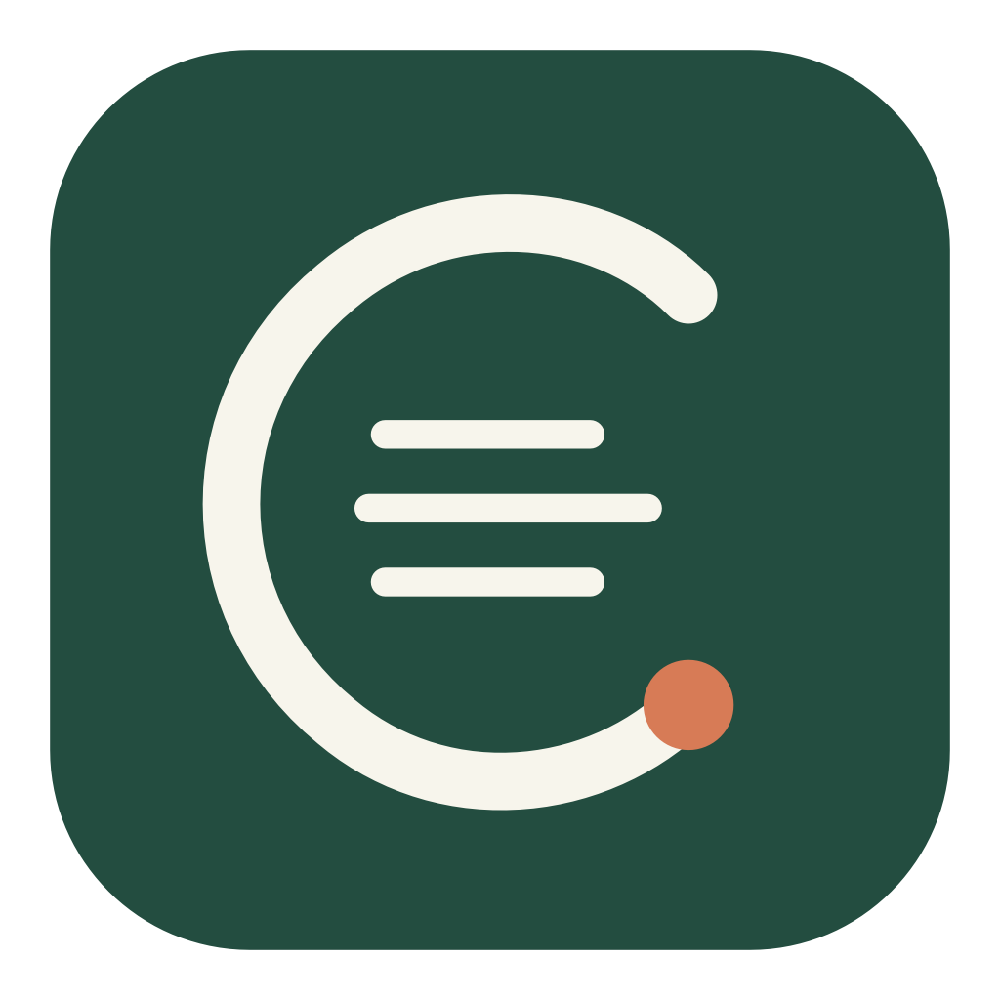
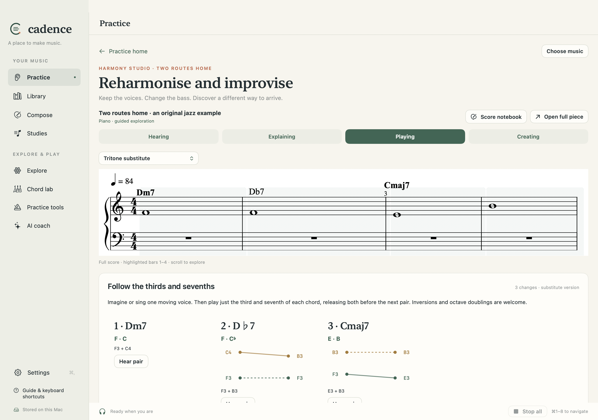

<p align="center"></p>

# Cadence

**A place to make music.** A native Mac studio for learning piano, guitar and music theory through the music you care about.

Hear an idea. Imagine it. Find it under your fingers. Make something of your own.
Cadence connects scores, listening, instrument practice and composition, with separate evidence for **hearing, explaining, playing and creating**. No paid lessons, advertising, streak penalties or account required. Optional AI uses your own OpenRouter account and credits.

[Download the public preview](https://github.com/cigrainger/cadence/releases/tag/v0.36.0) · [User guide](https://cigrainger.github.io/cadence/docs/) · [Project website](https://cigrainger.github.io/cadence/) · [Contribute](CONTRIBUTING.md)



## Make music, from several directions

- **Explore:** keys, scales, modes, chord tones, guitar shapes and piano visualisations. Guitar voicings are calculated from tuning and chord intervals; they are not a scraped chord database.
- **Compose:** linked notation and guitar tab, piano staves, chord symbols, MIDI step entry, playback and editable MusicXML import/export.
- **Bring your music:** a library separating imported scores and your compositions. Optional PDF transcription produces an editable draft beside its source. EPUB/PDF chapters can support reviewed, source-linked courses.
- **Practise:** functional ear training and solfège, MIDI play-along, rhythms, hands separately/together, phrase takes, guitar triads, guide tones and reharmonisation. Focus on a difficulty, return to the phrase, then try independently later.
- **Create:** write an answer or alternative ending, save a reharmonisation, and record MIDI improvisations linked to the original piece.
- **Keep the basics nearby:** metronome, tuner, pitch matching and optional AI explanations.

This is an early public release. AI transcription is fallible and needs review. Cadence is not a lossless general-purpose engraving tool. Guitar microphone work is monophonic pitch matching, not reliable polyphonic chord recognition. See the [guide](https://cigrainger.github.io/cadence/docs/) for each activity's boundaries.

## Install

The first published binary is for **Apple silicon, macOS 14 or later**. Download the app ZIP and verify its SHA-256 against the release's `SHA256SUMS.txt`, then extract and move Cadence to Applications. Releases include matching source, dependency records and notes.

The preview is **ad hoc signed, not Apple notarised**. macOS may block a downloaded app. Use Apple's normal Privacy & Security review process only if you trust this source; no command that disables Gatekeeper is required or recommended. You can also build locally. Intel builds are not yet release-tested.

## Build from source

Requires macOS 14+, Xcode with a Swift 6 toolchain, Python 3.11+ for verification/site tooling, and Node.js for JavaScript syntax checks. No Xcode project or npm install is needed for the app. SwiftPM fetches the exact ZIPFoundation version in `Package.resolved`.

```sh
git clone https://github.com/cigrainger/cadence.git
cd cadence
./build.sh
open dist/Cadence.app
```

`CADENCE_BUILD_DIR` and `CADENCE_APP_PATH` optionally select the build cache and output bundle. The build stages a fresh bundle; it only replaces an output recognised as Cadence.

```sh
python3 Scripts/check_repository.py
./verify.sh --tests-only                 # core + native state tests, coverage
./verify.sh                              # also native previews, audio and renderer checks
python3 Scripts/build_site.py            # site/dist, including internal-link checks
```

Full verification requires a logged-in Mac desktop. It uses original fixtures and isolated preview state, never your API key, microphone or saved library. See [Testing](Docs/TESTING.md) and [Architecture](Docs/ARCHITECTURE.md).

## Your data and your music

Your library and progress live in `~/Library/Application Support/Cadence`. The API key lives in the macOS Keychain. AI requests send the selected material and prompt to OpenRouter only when requested, with zero-data-retention routing required. Your provider's terms and billing still apply. Microphone pitch analysis is local. There is no app telemetry or website analytics.

Back up Application Support before experimenting with development builds. Imported books, private scores, model responses, recordings and keys do **not** belong in this repository. The app's license does not impose a license on music you create or import. See [Security](SECURITY.md) and [Licensing](LICENSING.md).

## Free software, maintained in public

First-party code is **AGPL-3.0-or-later**. Original documentation, examples and visual assets are **CC-BY-SA-4.0**. Third-party components keep their own licenses; see [Third-party software](THIRD_PARTY.md) and the [dependency inventory](Dependencies/components.json).

Contributions are welcome: teaching ideas, bug reports, accessibility testing, documentation, translations and code. There is no copyright assignment or proprietary relicensing CLA. We use signed-off commits to confirm contribution rights. Please read [Contributing](CONTRIBUTING.md).
